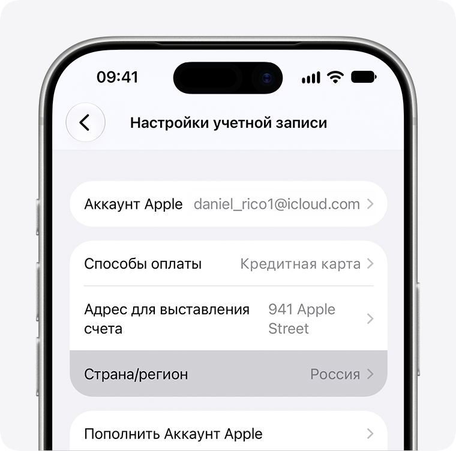

# Подключение

### Я оплатил, куда нажимать дальше, чтобы VPN заработал? {: #first-connection }

1. Нажмите **«Меню»** в нижней клавиатуре Telegram.
2. Выберите **«Подключить VPN»**.
3. Скопируйте персональную ссылку, которую покажет бот.
4. Установите Happ или incy и добавьте ссылку в приложение с помощью кнопки вставки.
5. Выберите подходящую локацию и включите VPN.

Ссылки на приложения для каждой платформы собраны здесь: [Кликните](general.md#apps).

---

### Какую локацию для подключения выбрать?
**Белые списки** — позволяет обходить региональные ограничения, когда не открывается ничего кроме ВК и Яндекса. Трафик для этих локаций входит в каждый тариф, при необходимости его можно докупить. [Подробнее о лимитах и расчёте трафика](whitelist.md).

**Лучшая локация** — приоритетный выбор, выбирает лучшую локацию из связок «РФ -> Зарубежная страна». Выбирайте это, если не нужна конкретная зарубежная страна.

**РФ -> Зарубежная страна** — российские сайты открываются при включённом VPN, YouTube без рекламы.

**Зарубежная страна** — обычный впн, прямое подключение к зарубежной стране. Может быть стабильнее для игр.

---

### Какое приложение для подключения использовать?
Подойдёт любой современный V2Ray-клиент, умеющий передавать HWID (ID устройства).

Например, Happ или incy. Ссылки на скачивание здесь: [Кликните](general.md#apps)

---

### Как сменить регион App Store на iPhone и iPad? {: #app-store-region }

1. **Заранее скачайте и обновите нужные российские приложения**, в том числе банковские. В зарубежном App Store части из них может не быть, поэтому после удаления или на новом устройстве скачать их заново может не получиться.

2. **Проверьте баланс Аккаунта Apple:** откройте App Store и нажмите значок своего профиля. Желательно, чтобы баланс был нулевым. Если на счёте есть деньги, сначала попробуйте сменить регион по шагам ниже. Только если Apple выдаст ошибку из-за остатка, израсходуйте его или обратитесь в [официальную поддержку Apple](https://support.apple.com/ru-ru/contact) за помощью со сменой региона и остатком на счёте. Возврат в российский регион тоже не всегда получается сразу: ему могут помешать баланс уже в новой стране, подписки или незавершённые покупки и возвраты.

3. Откройте **«Настройки»** на iPhone или iPad и нажмите **своё имя** вверху.

4. Выберите **«Медиаматериалы и покупки»** или **«Контент и покупки»**, затем **«Просмотреть»**. При необходимости подтвердите вход.

5. Откройте **«Страна/регион»**. Если есть кнопка **«Изменить страну или регион»**, нажмите её.

    ??? info "Показать скриншот"

        

6. Выберите **«Соединённые Штаты»**, нажмите **«Продолжить»** и примите условия. Не отменяйте все подписки заранее: если Apple сообщает, что переходу мешает конкретная подписка или семейный доступ, сначала устраните именно указанную причину.

7. В разделе **«Способ оплаты»** выберите пункт **«Нет»** — в английском интерфейсе он называется **None**. Это означает, что вы не привязываете банковскую карту. Если такого пункта нет и форма требует карту, понадобится способ оплаты, подходящий для США: заполнение одного адреса это требование не отменяет.

8. Укажите **свои имя и фамилию латиницей**.

9. **Заполните адресные поля.** Адрес не обязательно должен быть вашим личным — можно использовать эти значения:

    - **Улица / Street:** `100 Continental Dr`.
    - **Вторая строка адреса:** оставить пустой.
    - **Город / City:** `Newark`.
    - **Штат / State:** `Delaware`.
    - **Индекс / ZIP:** `19713`.

10. **Укажите свой номер телефона.** Если телефонное поле именно в адресной форме принимает только номер США, в нём можно использовать пример: код `302`, номер `4541500` (для одного поля — `3024541500`). Для входа в Аккаунт Apple, кодов подтверждения и восстановления оставьте свой доступный номер.

11. Нажмите **«Готово»** или **«Далее»**. После успешного сохранения заново откройте App Store и страницу нужного приложения.

---

### Как подключиться с помощью QR-кода?

Откройте **«Меню» → «Подключить VPN» → «QR-код»**. Отсканируйте код в приложении на другом устройстве — в нём
закодирована та же персональная ссылка, которую бот показывает текстом.

Не публикуйте ссылку и QR-код и не передавайте их посторонним: они дают доступ к вашей подписке в пределах лимита
устройств.

---

### Когда нужно обновлять персональную ссылку?

Если ссылка или QR-код попали к постороннему человеку, откройте **«Меню» → «Подключить VPN» → «Обновить ссылку»** и
подтвердите действие. Предыдущая ссылка и все добавленные по ней конфигурации сразу перестанут работать. После обновления
добавьте новую ссылку заново на своих устройствах.

Обычное обновление списка локаций не требует менять персональную ссылку — используйте кнопку обновления внутри Happ,
incy или другого приложения.

---

### Как обновляются локации?

Приложение автоматически получает актуальные локации раз в несколько часов. Чтобы не ждать, нажмите кнопку обновления конфигурации
вручную. Это особенно важно сразу после покупки трафика белых списков или изменения доступных локаций.

---

### Как подключить VPN на новом устройстве?
Скопируйте вашу ссылку на VPN из бота и добавьте её в приложение на новом устройстве. Устройство добавится автоматически. Неиспользуемые устройства можно удалить через меню бота. Вы можете делиться доступом с близкими в рамках вашего лимита.

Удалить одно или сразу все неиспользуемые устройства можно по маршруту **«Меню» → «Подключить VPN» →
«Мои устройства»**. Подробнее о лимите устройств: [Кликните](general.md#limit-devices)

---

### Как подключить веб-прокси для Telegram? {: #telegram-web-proxy }

Веб-прокси доступен при действующем **Пробном**, **Оптимальном** или **Максимальном** тарифе. На Базовом тарифе кнопки
подключения нет. [Подробнее об условиях доступа](general.md#telegram-web-proxy).

1. Откройте **«Меню»** в нижней клавиатуре Telegram.
2. Нажмите **«ТГ-прокси»**.
3. Нажмите предложенную ботом кнопку **«Подключить»** и подтвердите добавление и включение прокси в Telegram.
4. Если кнопок несколько, добавьте доступные веб-прокси по очереди и выберите работающий в настройках Telegram.
5. Проверьте, что сообщения и медиа загружаются.

Ссылка открывается в приложении Telegram с поддержкой WEB-прокси. Вставлять её в Happ, incy или адресную строку
Telegram Web не нужно. Если Telegram не распознаёт ссылку, обновите приложение; если ваш клиент не поддерживает
этот формат, используйте VPN.

Для звонков в Telegram и работы при ограничениях «белых списков» используйте VPN. Для белых списков выберите
одноимённую VPN-локацию.

---

### Как подключить веб-прокси на другом устройстве? {: #share-tg-proxy }

Откройте того же бота под своим Telegram-аккаунтом на другом устройстве и повторите действия
**«Меню» → «ТГ-прокси» → «Подключить»**. Для каждого устройства нужен клиент Telegram с поддержкой WEB-прокси.

**На телефоне:** у WEB-прокси нет кнопки «Поделиться» в настройках Telegram. Зажмите кнопку нужного прокси
**«Подключить»** в сообщении бота → **«Скопировать ссылку»** и отправьте её человеку.

**На компьютере:** можно нажать **«Поделиться»** в настройках WEB-прокси либо кликнуть по кнопке прокси
в сообщении бота правой кнопкой мыши → **«Скопировать ссылку»**.

Получателю понадобится Telegram с поддержкой WEB-прокси.

Ссылка персональная: не публикуйте её и передавайте только тем близким, с кем делитесь доступом
в пределах [лимита тарифа](general.md#limit-devices).

---

### Как обновить ссылки на веб-прокси? {: #web-proxy-link-update }

Если доступ попал к посторонним, откройте **«Меню» → «ТГ-прокси» → «Обновить ссылку»** или **«Обновить ссылки»**,
затем нажмите **«Да, обновить»**. Действие обновляет все ваши ссылки на прокси.

После успешного обновления старые ссылки перестанут работать. Заново подключите веб-прокси через новые кнопки
**«Подключить»** на всех своих устройствах. Старые записи можно удалить из настроек прокси Telegram.

!!! Warning "Не обновляйте ссылки без необходимости"
    Для подключения ещё одного устройства или обычного продления тарифа менять ссылки не требуется.
    Восстановить прежние ссылки после перевыпуска нельзя.

---

### Настройка на роутере
Мы не предоставляем поддержку роутеров. При самостоятельной настройке убедитесь, что ваша программа для подключения передает HWID (ID устройства), иначе подключить не получится.

---

### Режимы Proxy и TUN на компьютере
Для браузеров рекомендуется стабильный режим **Proxy**. Режим **TUN** нужен только тогда, когда необходимо принудительно завернуть весь трафик системы в VPN. Discord также запускается именно при активном режиме **TUN**. Если режим **TUN** не работает, запустите программу от имени администратора. 

При выборе режима **TUN** выбирайте **Sing-box**, если такая настройка есть.
